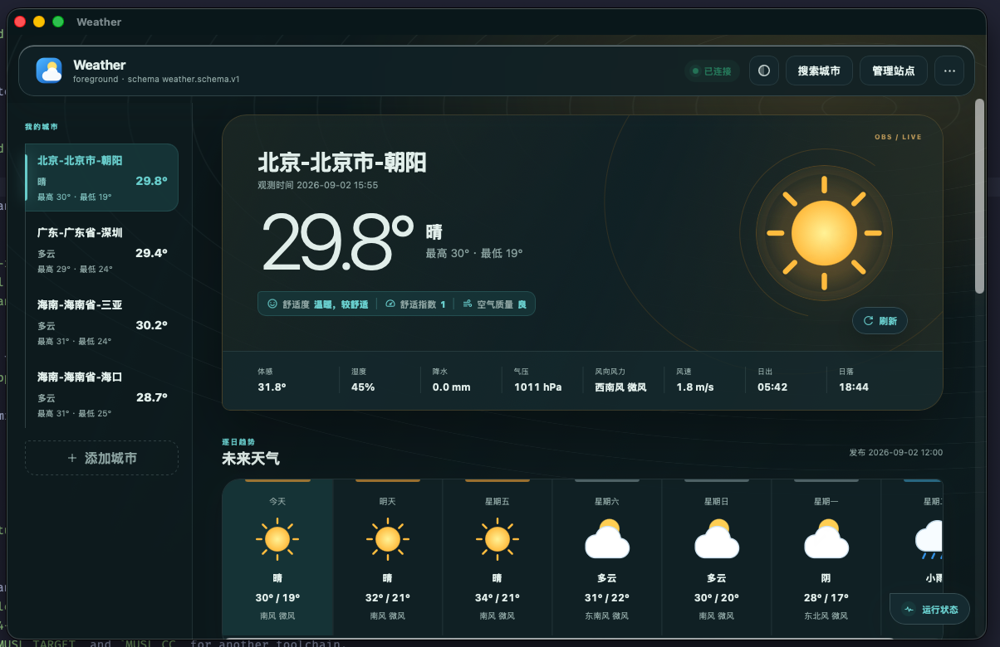
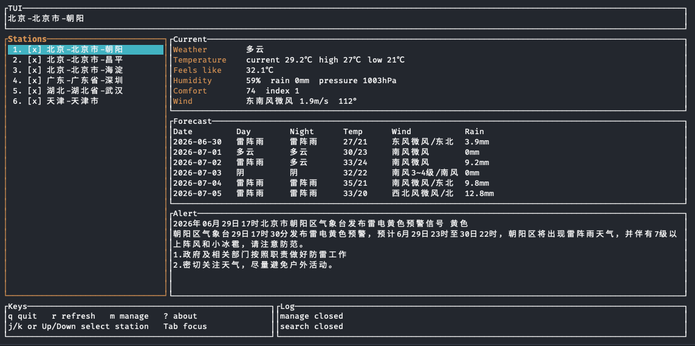

# Weather App

Weather App is a cross-platform weather client written in Rust. It ships as
one BusyBox-style `weather.app` executable with optional daemon, terminal, and
desktop interfaces.

Weather data comes from the NMC provider and is served through a local engine.
The GUI and TUI share the same configuration, cache, and engine protocol.





## Features

- One executable for GUI, TUI, and daemon modes.
- Desktop GUI for Linux, Windows 10, and macOS.
- Interactive TUI and one-shot text or JSON output.
- Station search, management, forecasts, alerts, and temperature history.
- Local caching, background refresh, proxy support, and stale-data fallback.
- systemd services on Linux and Windows SCM service installation.

The executable selects its interface from the launch environment:

```sh
weather.app                  # TUI in a terminal; GUI on desktop launch
weather.app gui              # Explicit GUI
weather.app tui              # Explicit TUI
weather.app tui once         # One-shot weather output
weather.app tui --format json once
weather.app daemon status    # Control the local engine
```

Renaming or symlinking the executable to `weather-daemon`, `weather-tui`, or
`weather-gui` selects that mode directly.

Configuration defaults to `~/.weather/config/weather.toml`. Use
`-c/--config <path>` to select another file.

## Build

Requirements:

- Stable Rust toolchain.
- Bun 1.3.14.
- Native Tauri dependencies for the target platform.

Ubuntu 22.04 is the minimum supported Linux build target. See the
[GUI development notes](weather-renderer/gui/README.md) for platform packages
and bundle prerequisites.

### Default bundle

The default Make target builds an installable bundle for the current platform.
It uses the `desktop` feature set, so the bundle contains the daemon, TUI, and
GUI in one `weather.app` application.

```sh
make
# Equivalent:
make bundle
```

The bundle is written to `target/release/bundle/`. The exact installer formats
depend on the host platform and the Tauri configuration.

### Other release variants

Make can also produce optimized single-file releases for a selected interface:

```sh
make gui         # Current platform: daemon + GUI
make tui         # Current platform: daemon + TUI
make musl-tui    # x86_64 Linux musl: static daemon + TUI
```

These files and their SHA-256 checksums are written to
`target/release-artifacts/<target-triple>/<variant>/`. `make musl-tui` requires
the `x86_64-unknown-linux-musl` Rust target and a compatible musl C compiler;
override `MUSL_TARGET` and `MUSL_CC` for another target.

GitHub Actions publishes the latest installable bundles after a successful
`master` build:

- `weather-linux-x86_64-latest`
- `weather-windows-x86_64-nsis-latest`
- `weather-windows-x86_64-tar-latest`
- `weather-macos-universal-latest`
- `weather-macos-aarch64-latest`

Each platform target retains its newest successful artifact independently.

## Development

Development builds are not packaged releases. They either depend on the Vite
development server or only compile a selected feature set for local testing.

### GUI development

Run the GUI with Vite hot reload:

```sh
cd weather-renderer/gui
bun install --frozen-lockfile
bun run tauri dev
```

`bun run tauri dev` compiles the `desktop` feature set and connects the GUI to
the local Vite server; the result is not a standalone release bundle.

For a standalone debug executable with embedded frontend assets:

```sh
cd weather-renderer/gui
bun install --frozen-lockfile
bun run standalone:debug
../../target/debug/weather.app gui
```

For frontend-only development checks:

```sh
cd weather-renderer/gui
bun test
bun run build
```

### Feature builds

Use Cargo directly when developing or testing an individual application
feature. These debug builds do not create an installable bundle:

```sh
cargo build -p weather-app                    # daemon
cargo build -p weather-app --features tui     # daemon + TUI
cargo build -p weather-app --features gui     # daemon + GUI
cargo build -p weather-app --features desktop # daemon + TUI + GUI
```

### Checks

Run the workspace checks before submitting changes:

```sh
cargo fmt --all -- --check
cargo clippy --workspace --all-targets --all-features -- -D warnings
cargo test --workspace --all-features
```

Install the daemon as a Linux user service when needed:

```sh
weather.app daemon service install systemd
```

Windows service installation requires an elevated terminal and system scope:

```powershell
weather.app.exe daemon service install windows --system
```

## License

WTFPL.
